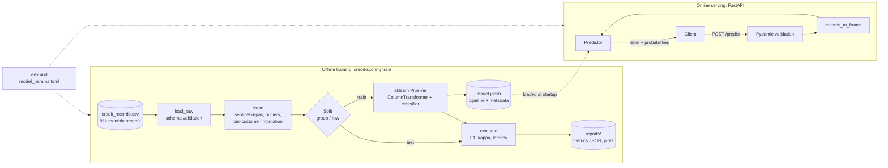

# Credit Score Classifier


## Project Overview

**Classifies a bank customer's credit score as *Poor / Standard / Good* from 30+ monthly financial signals and serves the prediction through a validated REST API, with an evaluation that holds out whole customers so the numbers reflect performance on applicants the model has never seen.**

This started as an exploratory notebook that reached ~0.80 F1. Turning it into a service exposed that the notebook's random row split put the same customers in both train and test. With customer-grouped evaluation the true F1 is ~0.69. This repo reports both numbers, and the gap is the main finding.

## Key Features

- **Leakage-free evaluation.** `StratifiedGroupKFold` keeps every record of a customer on one side of the split. The original row split shared 9,568 customers between train and test, which inflated weighted F1 by 11 to 18 points. Both strategies can be selected with one setting (`CREDIT_SPLIT_STRATEGY`).
- **Same preprocessing in training and serving.** All cleaning-independent preprocessing lives inside one scikit-learn `Pipeline` that is saved as a single artifact. A custom `MultiHotEncoder` learns the loan-type vocabulary during `fit`. The notebook used `pd.get_dummies`, which produces different columns for a single-row request than for the training data, so it could not serve one request at a time.
- **FastAPI inference service.** It has Pydantic v2 request validation (ranges, enums, unknown fields rejected), single and batch endpoints, a batch-size limit (413), returns 503 when no model is loaded, and offers OpenAPI docs at `/docs`.
- **Faster serving.** Models train with all cores, then switch to single-threaded prediction before they are saved. That cut p50 latency for one request from 28.8 ms to 7.5 ms for the random forest (3.8×) with identical predictions.
- **Production layout.** The code is a `src/` package with typed functions and docstrings. Settings come from `.env` / environment variables (no hardcoded paths), and hyperparameters from a TOML file. A multi-stage Docker image runs as a non-root user, and `docker compose up` trains the model and then serves it. The 110 pytest tests cover 99% of the code.

## System Architecture



Inside the pipeline, the `ColumnTransformer` handles each feature group differently:

| Feature group | Columns | Transform |
|---|---|---|
| Numeric | 19 (income, debt, delays, history…) | median impute → `StandardScaler` (KNN only) |
| Ordinal | `credit_mix` | `OrdinalEncoder` Bad < Standard < Good |
| Nominal | occupation, payment behaviour | `OneHotEncoder(handle_unknown="ignore")` |
| Multi-label | `loan_types` … `loan_types_9` | custom `MultiHotEncoder` (9 loan types) |

## Tech Stack

| Area | Tools |
|---|---|
| Language | Python 3.11+ (type-hinted, PEP 8 via Ruff) |
| ML | scikit-learn · XGBoost · pandas · NumPy |
| Serving | FastAPI · Uvicorn · Pydantic v2 · pydantic-settings |
| Quality | pytest · pytest-cov · Ruff (lint and format) |
| Ops | Docker (multi-stage, non-root) · Docker Compose · joblib artifacts |

## Quick Start

### 1. Local (Python 3.11+)

```bash
git clone <your-repo-url> credit-score-classifier && cd credit-score-classifier
python -m venv .venv
source .venv/bin/activate          # Windows: .venv\Scripts\activate
pip install -e ".[dev]"
cp .env.example .env               # optional; every setting has a default
```

Train all three models. This takes about 1 minute on a laptop and writes `models/*.joblib` and `reports/`:

```bash
credit-scoring train --model all
```

Serve the default model (`CREDIT_MODEL_NAME`, XGBoost):

```bash
credit-scoring serve --port 8000
```

### 2. Docker (one command)

```bash
docker compose up --build
```

The `train` service fits the model into a shared volume. The `api` service starts once training completes successfully. Open http://localhost:8000/docs.

### 3. Call the API

```bash
curl -X POST http://localhost:8000/predict -H "Content-Type: application/json" -d '{
  "record_month": 3, "customer_age": 35, "customer_occupation": "Engineer",
  "annual_income": 65000, "monthly_salary": 5400, "bank_accounts": 3, "credit_cards": 4,
  "interest_rate": 12, "loans": 2, "loan_types": ["Auto Loan", "Student Loan"],
  "payment_delay_days": 10, "delayed_payments": 4, "credit_limit_changes": 6.5,
  "credit_inquiries": 3, "credit_mix": "Good", "outstanding_debt": 800,
  "credit_utilization": 31.2, "credit_history_age_months": 240, "min_amount_payment": false,
  "monthly_emi": 90, "monthly_investment": 150,
  "payment_behavior": "Low_spent_Small_value_payments", "monthly_balance": 400 }'
```

```json
{"credit_score": "Good", "confidence": 0.493,
 "probabilities": {"Poor": 0.082, "Standard": 0.425, "Good": 0.493}}
```

| Endpoint | Purpose |
|---|---|
| `GET /health` | Liveness and whether a model is loaded |
| `GET /model/info` | Model name, training time and test metrics |
| `POST /predict` | Score one record |
| `POST /predict/batch` | Score up to `CREDIT_API_MAX_BATCH_SIZE` records |

### Configuration

All settings are environment variables with the prefix `CREDIT_`. See [`.env.example`](.env.example). Hyperparameters and search grids are in [`config/model_params.toml`](config/model_params.toml). To run a grid search with customer-grouped cross-validation:

```bash
credit-scoring tune --model knn
```

### Tests

```bash
pytest --cov
ruff check src tests && ruff format --check src tests
```

## Evaluation & Benchmarks

The test set is a held-out 20% (16,752 records). With the group split, none of those customers appear in training. Full reports are in [`reports/`](reports).

### Model quality: customer-grouped split (headline numbers)

| Model | Accuracy | Weighted F1 | Macro F1 | Cohen's κ | Recall Poor / Std / Good |
|---|---:|---:|---:|---:|---|
| **Random Forest** | **0.693** | **0.692** | **0.664** | **0.483** | 0.65 / 0.76 / 0.56 |
| XGBoost | 0.687 | 0.684 | 0.651 | 0.465 | 0.65 / 0.78 / 0.49 |
| KNN (k=5, L1) | 0.623 | 0.619 | 0.578 | 0.360 | 0.58 / 0.72 / 0.41 |

### How much leakage inflated the original numbers

| Model | Original notebook F1 (row split) | This repo, row split | This repo, **group split** | Δ group − row |
|---|---:|---:|---:|---:|
| KNN | 0.796 | 0.797 | 0.619 | −0.18 |
| XGBoost | 0.780 | 0.809 | 0.684 | −0.13 |
| Random Forest | 0.798 | 0.799 | 0.692 | −0.11 |

The refactored pipeline reproduces the notebook's row-split scores, which validates the refactor. The drop under the group split is the size of the leakage. Each customer has about 7 consecutive monthly records with near-identical features, so a row split lets the model recognise customers it has already seen instead of generalising to new ones.

### Inference performance

Measured on an AMD Ryzen CPU (16 threads), Python 3.13, single process, after `configure_for_serving`:

| Model | p50 latency (1 row) | p95 latency (1 row) | Batch throughput | Artifact size | Fit time |
|---|---:|---:|---:|---:|---:|
| XGBoost | **2.5 ms** | 2.8 ms | **21,200 rows/s** | 15.9 MB | 6.7 s |
| Random Forest | 7.5 ms | 7.8 ms | 10,800 rows/s | 104.6 MB | 3.7 s |
| KNN | 4.4 ms | 4.8 ms | 530 rows/s | 9.6 MB | 0.4 s |

Peak Python-heap allocation while scoring a 1,000-row batch is about 0.7 MB for every model (`tracemalloc`). XGBoost is the default served model. Its F1 is within 0.01 of the random forest, it is 3× faster per request and its artifact is 6.6× smaller.

## Data Cleaning Notes

These are the cleaning rules in `credit_scoring.data.clean`, all covered by unit tests:

- **Credit-history sentinel repair.** Records where the text field is missing carry a placeholder of 219 months. Credit history grows by one month per record, so each value is rebuilt from the same customer's valid rows. *This fixes a bug in the original notebook, which wrote `record_month` (1–8) into these 8,230 rows.*
- **Age outliers** (> 90) are replaced with the customer's median valid age.
- **Income typos.** Values above the IQR fence that appear at most 3 times are dropped. Genuine high earners repeat their income across monthly records.
- **Occupation** is imputed with the customer's mode, falling back to `"Unknown"`.

## Project Structure

```
├── config/model_params.toml     # hyperparameters and tuning grids
├── data/raw/credit_records.csv  # dataset (91,282 monthly records)
├── notebooks/                   # original exploratory notebook (archived)
├── src/credit_scoring/
│   ├── config.py      # pydantic-settings: env vars and .env
│   ├── schema.py      # column groups and label vocabularies
│   ├── data.py        # load, validate, clean, split
│   ├── features.py    # ColumnTransformer and MultiHotEncoder
│   ├── models.py      # pipeline factory (KNN / XGBoost / RF)
│   ├── train.py       # train, tune, persist artifacts
│   ├── evaluate.py    # metrics, latency and memory benchmarks
│   ├── predict.py     # request schema and Predictor
│   ├── api.py         # FastAPI app
│   └── cli.py         # `credit-scoring` entry point
├── tests/
│   ├── unit/          # data, features, models, metrics, config, schema
│   └── integration/   # end-to-end training, CLI and API
├── Dockerfile · docker-compose.yml · pyproject.toml · requirements*.txt
```

## Project Background

The modelling began as a team exploratory notebook that cleaned the data and compared three tuned baselines: KNN, XGBoost and Random Forest. This repository turns that work into a tested, configurable and deployable service. It also re-evaluates every model on customers held out from training, fixes a cleaning bug, and makes the preprocessing work for single-record inference. The original notebook is kept in [`notebooks/`](notebooks) for reference. The data comes from the public Kaggle *Credit Score Classification* dataset.
